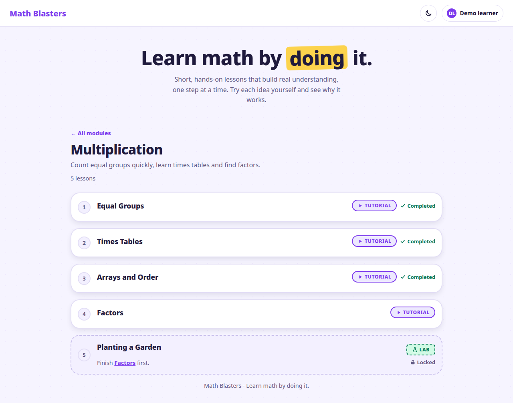
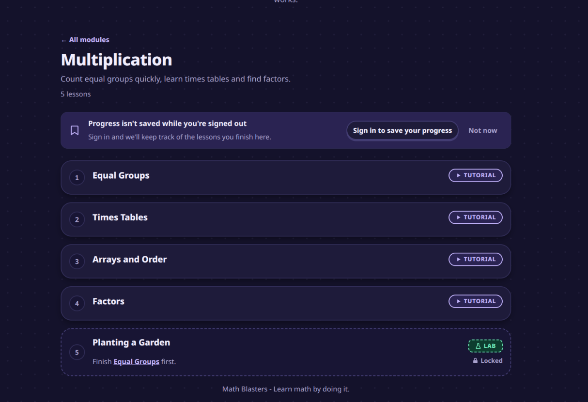

# Math Blasters

**Learn math by doing it.** Math Blasters teaches basic math through short,
hands-on lessons you work through in the browser: you try each idea yourself
and get feedback straight away, rather than reading about arithmetic.

Built by the freeCodeCamp Summer 2026 Cohort.





## How it works

- **Modules** cover one topic: addition, subtraction, multiplication, division,
  fractions, an introduction to algebra.
- Each module is a short run of **tutorials**, a few minutes each: an
  explanation, then a question or two to try.
- It ends in a **lab**, a longer task that puts the module's ideas to work. A
  lab unlocks once you've finished the tutorials it builds on.
- A wrong answer isn't an error. You get a "not yet", a nudge about what to
  look at, and another go. The answer is never shown to you.
- Sign in with GitHub or Google to save your progress across devices. Without
  signing in, you can still try the tutorials, but nothing is saved.

## Team

- [akshayavb99](https://github.com/akshayavb99) - developer
- [bappyasif](https://github.com/bappyasif) - developer
- [bijiyiqi2017](https://github.com/bijiyiqi2017) - developer
- [GnautSpace](https://github.com/GnautSpace) - developer
- [imsomilg](https://github.com/imsomilg) - team lead
- [SaugatDh](https://github.com/SaugatDh) - developer
- [SGM-dev](https://github.com/SGM-dev) - developer

Want to join in? [CONTRIBUTING.md](./CONTRIBUTING.md) explains how to claim an
issue and what review looks for.

## Quickstart

You need [Docker](https://docs.docker.com/get-docker/). Then:

```bash
./scripts/dev-setup.sh
```

It creates `.env` from `.env.example` if you don't have one, then starts three
services:

- `web`: the app, at [http://localhost:5173](http://localhost:5173)
- `api`: FastAPI at [http://localhost:8000](http://localhost:8000), with
  interactive docs at [/docs](http://localhost:8000/docs)
- `db`: PostgreSQL, on port **5433** so it doesn't clash with a Postgres you
  may already run on 5432

Lessons work straight away. Signing in needs your own GitHub or Google OAuth
app; [docs/local-development.md](docs/local-development.md) walks through it,
along with running without Docker and fixing common setup problems.

## How it fits together

- **Lessons are markdown files** in [`content/`](./content), read into the web
  app at build time. They never go near the database.
- **Answers are checked in the browser**, by one pure function in
  `web/src/content/`. There's no round trip, so feedback is instant.
- **The API stores who you are and what you've finished**, and nothing else.

Every PR is reviewed against two rules:

1. **No expected value is ever rendered.** Not in the page, not in a screen
   reader announcement, not in a feedback sentence.
2. **The API stores no content and grades nothing.**

Yes, that means the answers are in the JavaScript bundle. That's deliberate,
and [docs/content-model.md](docs/content-model.md) explains why grading isn't
done on the server.

### Stack

- **Web**: React 18, TypeScript, Vite, React Router. Plain CSS with design
  tokens, no CSS framework. mathjs for symbolic checks, KaTeX for maths.
- **API**: FastAPI (Python 3.12), SQLAlchemy 2.0, Alembic, PostgreSQL 16.
- **Tests**: Vitest and Testing Library (web), pytest (API).

### API

Every route lives under `/api`. There are deliberately no content routes:
lessons ship with the web app, so the API never serves, stores or checks them.

| Method | Route | What it does |
| --- | --- | --- |
| GET | `/api/health` | Liveness check |
| GET | `/api/auth/{provider}/start` | Starts GitHub or Google sign-in (`github`, `google`) |
| GET | `/api/auth/{provider}/callback` | Where the provider sends you back; signs you in |
| GET | `/api/auth/me` | The signed-in account, or `null` when signed out |
| POST | `/api/auth/logout` | Signs out and issues a fresh signed-out identity |
| POST | `/api/completions` | Records a lesson as complete. Takes `{"lesson_slug": "..."}` only; needs sign-in; rate limited |
| GET | `/api/progress` | The lesson slugs you've completed (empty when signed out) |

Errors share one shape:

```json
{
  "error": {
    "code": "not_found",
    "message": "Human-readable description",
    "details": null
  }
}
```

### Layout

```
math-blasters/
├── content/              lessons, one markdown file each, plus manifest.json
├── web/
│   ├── src/
│   │   ├── content/      lesson parser, answer checker, build-time index
│   │   ├── pages/        one component per route
│   │   ├── components/   lesson stepper, feedback, sign-in and the rest
│   │   ├── context/      auth and progress state
│   │   ├── api/          typed fetch client
│   │   └── styles/       tokens.css (design tokens) and global.css
│   ├── scripts/          content validation and manifest generation
│   └── tests/
├── api/
│   ├── app/
│   │   ├── routers/      health, auth, completions, progress
│   │   ├── providers/    GitHub and Google OAuth
│   │   └── models.py     learners, accounts, OAuth identities, completions
│   ├── alembic/          migrations
│   └── tests/
├── docs/
└── docker-compose.yml
```

## Adding a lesson

A lesson is one markdown file. No code, no migration.

1. Add `content/<module>/<NN>-<lesson-slug>.md`, where `NN` orders it in the
   module. A new module also needs a `module.yaml`.
2. Write the frontmatter (`slug`, `type`, `title`, and `teaches` or
   `requires`), then `--explain--` and `--answer--` steps.
   `content/arithmetic-addition/01-adding-two-numbers.md` is a good one to copy.
3. From `web/`, run `npm run content:validate` to check it.
4. From `web/`, run `npm run content:manifest` and commit the updated
   `content/manifest.json`.
5. Open a PR.

The full format, every kind of check, and how to write hints and feedback that
don't give the answer away are in
[docs/content-model.md](docs/content-model.md#writing-a-lesson).

## Documentation

- [docs/content-model.md](docs/content-model.md): how lessons, checking and
  progress work, and why grading isn't server-side
- [docs/local-development.md](docs/local-development.md): OAuth setup, running
  without Docker, troubleshooting
- [docs/testing.md](docs/testing.md): running tests, lint and type checks the
  way CI does
- [docs/accessibility.md](docs/accessibility.md): the accessibility baseline
- [CONTRIBUTING.md](./CONTRIBUTING.md): claiming an issue, branches, PRs and
  review

## License

[MIT](./LICENSE)
